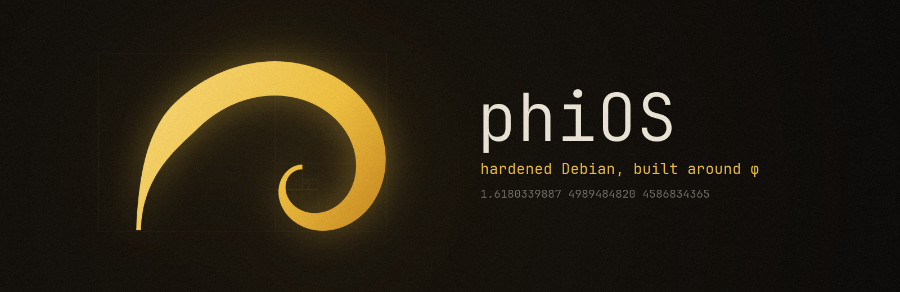
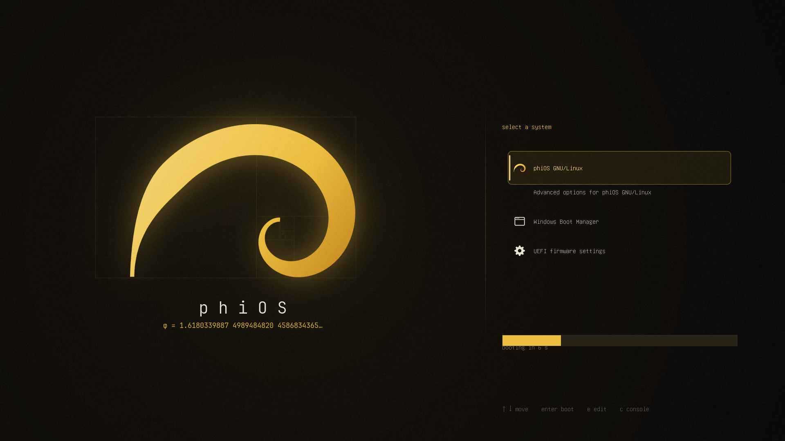

<p align="center">
  
</p>

<p align="center">
  <a href="https://github.com/convolutionary/phiOS/actions/workflows/tests.yml"></a>
  
  
  
  
  <a href="LICENSE"></a>
</p>

phiOS installs a hardened, LUKS2-encrypted Debian 13 next to an existing Windows install, then ports the HyDE Hyprland desktop from Arch onto it. The golden ratio shows up wherever it fits: the logo is Debian's swirl redrawn as a true golden spiral, the boot menu is laid out on golden sections, and the system info screen draws a different φ figure every time you open a terminal.

```sh
./install.sh --demo     # watch the installer run with fake steps, no root, no disks touched
```

## What you get

- **Debian 13 "trixie"**, debootstrapped, with backports enabled.
- **Full-disk encryption.** The root is LUKS2: aes-xts with a 512-bit key, argon2id at 1 GiB of memory and 4 s per unlock. `/boot` is a separate 1 GiB ext4 partition, because GRUB can't unlock argon2id.
- **Secure Boot stays on.** Booting goes shim (Microsoft-signed) → GRUB (Debian-signed) → kernel (Debian-signed). `tests/test_secureboot.sh` boots the installed image under enforcing UEFI firmware to prove it.
- **NVIDIA's open driver** (branch 620) from NVIDIA's Debian repo, which RTX 50-series cards need. DKMS signs the modules with a key you enroll once at first boot.
- **Kernel and system hardening.** See [Hardening](#hardening).
- **Hyprland + HyDE** via `phios-hyde`, run after the first boot.
- **A themed GRUB** and **phifetch**, both described below.

## It won't touch Windows

The installer replaces exactly one existing Linux partition, and adds an `EFI/debian/` folder to the EFI partition on that same disk. The guard in `install.sh` checks everything before a single byte is written, and refuses if:

- the chosen EFI partition, or any EFI partition on the target disk, contains `EFI/Microsoft`, which means it's the Windows disk;
- the target isn't a Linux partition type, which rules out NTFS, BitLocker, MSR, recovery and the EFI partition itself;
- the EFI partition is on a different disk from the target;
- the target is mounted, held open by LUKS/LVM, or smaller than 20 GiB;
- the live system is running from that disk.

When it partitions:

- it saves a GPT backup first, which ends up in `/var/backups` on the new system;
- it writes exact sector ranges inside the old partition only, and checks afterwards that every other table entry is unchanged;
- it never writes the firmware fallback loader `\EFI\BOOT\BOOTX64.EFI`.

`tests/test_install.sh` installs into a disk image with an NTFS partition, an EFI partition shared with another bootloader, and a fake Windows disk attached. It then proves all three are byte-identical afterwards.

Best setup: Windows on one drive, phiOS on a Linux partition on a second drive. Shrink or create that partition from Windows Disk Management or a live USB first.

## Install

### 1. Windows side

In an admin PowerShell:

```powershell
.\windows\preflight.ps1        # report only
.\windows\preflight.ps1 -Fix   # also offers: turn off Fast Startup, keep the hardware clock in UTC
```

It reports Secure Boot, BitLocker, Fast Startup and the clock setting, and shows which disk is the Windows one. If BitLocker is on, save the recovery key somewhere other than that PC. Booting Windows through GRUB can make BitLocker ask for it once; booting Windows from the firmware boot menu avoids that.

### 2. USB stick

The USB makers write the **phiOS installer**: Debian's live ISO with phiOS and its tools added. Boot it and the installer starts by itself. They check the download against the release's `SHA256SUMS`, write the stick, then read every byte back. They only offer USB disks, refuse the system disk, and ask you to type the target before erasing it.

The installer ISO is built by this repo's release workflow (`live/build-iso.sh`):

- **Source:** Debian's live ISO, after checking it against Debian's CD signing key.
- **Boot chain:** Debian's signed shim, GRUB and kernel are left exactly as they are, so Secure Boot works the same.
- **Additions:** NetworkManager (a Wi-Fi picker), the disk tools the installer needs, and phiOS itself, which autostarts.
- **Removals:** Debian's own installer, so the image is about 0.6 GB smaller.

To check that an ISO really came out of that workflow, run `gh attestation verify <iso> -R convolutionary/phiOS`. The makers run that check themselves when `gh` is installed.

Windows, in an admin PowerShell:

```powershell
& ([scriptblock]::Create((irm https://raw.githubusercontent.com/convolutionary/phiOS/main/usb/make-usb.ps1)))
```

Linux or macOS:

```sh
bash <(curl -fsSL https://raw.githubusercontent.com/convolutionary/phiOS/main/usb/make-usb.sh)
```

`-Debian` (PowerShell) or `--debian` (shell) writes plain Debian live instead, checked against Debian's CD signing key. Then you start the installer by hand, as described below.

### 3. Run it

Boot the stick in **UEFI** mode. **Install phiOS** is the default menu entry:

- It gets online by itself on ethernet, and opens a Wi-Fi picker if there's no network.
- Then the installer starts.
- **Live shell, no installer** in the boot menu skips all of that.

To run it by hand, from that shell or from a plain Debian live stick:

```sh
sudo phios-install                                                  # on the phiOS stick
# plain Debian live stick:
wget -qO- https://github.com/convolutionary/phiOS/archive/main.tar.gz | tar xz
sudo phiOS-main/install.sh --check --target /dev/nvme1n1p3 --esp /dev/nvme1n1p1   # dry run, prints the plan
sudo phiOS-main/install.sh
```

The installer then:

1. asks for a user, hostname, timezone, disk passphrase and password;
2. makes you type the partition name and then `WIPE`;
3. runs for roughly 10 to 20 minutes;
4. asks whether phiOS or Windows should come first in the firmware boot order.

### 4. First boot

1. A blue **MOK management** screen appears: choose Enroll MOK → Continue → Yes, type the one-time password you set, and reboot. This is what lets the NVIDIA driver load with Secure Boot on.
2. Unlock the disk.
3. Log in and run `phios-hyde`. It takes 15 to 30 minutes.
4. Reboot, then choose **Hyprland (uwsm-managed)** at the login screen.

## The boot menu

<p align="center">
  
</p>

This is a real screenshot, taken by `tests/test_secureboot.sh` with Secure Boot enforced. The screen splits at W/φ. The mark sits on a golden-rectangle tiling whose converging point is the spiral's own pole, and the menu lives right of the split. GRUB runs before the disk is unlocked, so the theme lives on `/boot`. Debian's signed GRUB has `gfxmenu` and `png` built in, so the theme works with Secure Boot on. JetBrains Mono fonts are built at install time with `grub-mkfont`. With Secure Boot on, though, the screenshot shows GRUB drawing the menu text in its built-in font. The art comes from `tools/gengrub.py`.

## phifetch

```sh
phifetch                     # different logo, palette, digit count and φ fact each run
phifetch --logo sunflower    # swirl sunflower spiral phi digits fraction fibonacci pentagram
phifetch --palette wallbash  # match the current HyDE theme's colours
phifetch --seed 1618         # reproducible
```

The logos:

| Logo | What it is |
|---|---|
| `sunflower` | regenerated every run: seeds placed 137.5° (the golden angle) apart, coloured along their Fibonacci arms |
| `spiral` | regenerated every run: a logarithmic spiral that grows by exactly φ every quarter turn, with random rotation and handedness |
| `fibonacci` | the 1·1·2·3·5·8 tiling with its spiral traced through |
| `digits` | φ's digits in rows of Fibonacci length |
| `fraction` | φ's continued fraction |

On the bare console phifetch switches to 16 colours and glyphs the console font can draw.

## Hardening

Settings were checked against [kernel-hardening-checker](https://github.com/a13xp0p0v/kernel-hardening-checker). With Debian's stock signed kernel, phiOS passes 220 of its checks, up from 208 with the settings before that review. Nearly everything still failing is a compile-time kernel option, which only a custom kernel could change, and a custom kernel would lose Debian's Secure Boot signature. The rest are deliberate trade-offs, listed below.

Kernel command line (`/etc/default/grub.d/phios.cfg`):

| Parameter | Effect |
|---|---|
| `lockdown=confidentiality` | root can neither modify nor read kernel memory (blocks kprobes, `/dev/mem` and BPF kernel reads) |
| `module.sig_enforce=1` | only signed modules load, even with Secure Boot off |
| `slab_nomerge init_on_alloc=1 init_on_free=1 page_alloc.shuffle=1` | heap exploits get harder, freed memory is zeroed |
| `hardened_usercopy=1 kfence.sample_interval=100` | bounds-checks kernel/user copies and samples the heap for memory bugs |
| `randomize_kstack_offset=on` | random kernel stack offset per syscall |
| `vsyscall=none` `debugfs=off` | removes a fixed-address mapping and the debug filesystem |
| `iommu=force iommu.strict=1 iommu.passthrough=0 efi=disable_early_pci_dma` | blocks DMA attacks from devices |
| `bdev_allow_write_mounted=0` | nothing can write raw to a mounted disk |
| `proc_mem.force_override=ptrace` | only a debugger can force-write another process's memory |
| `random.trust_cpu=off random.trust_bootloader=off` | the RNG doesn't rely only on RDRAND or the bootloader seed |

Left off on purpose:

- `nosmt`, because it costs a large share of CPU throughput;
- `ia32_emulation=0`, because it breaks 32-bit Steam and Wine games;
- `pti` and `intel_iommu`, which only apply to Intel;
- `cfi=kcfi`, because Debian doesn't build its kernel with clang CFI.

Sysctls (`/etc/sysctl.d/99-phios-hardening.conf`):

- **Kernel info:** kernel pointers and dmesg are hidden.
- **Root-only features:** BPF, perf and io_uring need root.
- **Bug containment:** the kernel panics after 100 oopses or warnings, so a kernel bug can't be retried indefinitely.
- **ptrace:** attaching is admin-only (`gdb -p` needs sudo; `gdb ./prog` still works).
- **Exploit helpers off:** no kexec, userfaultfd or TIOCSTI.
- **Memory:** maximum ASLR entropy.
- **Filesystem:** protected links and fifos, and no setuid core dumps.
- **Network:** rp_filter on, redirects and source routing off.

Also:

- **Firewall:** nftables drops all inbound traffic except replies, DHCP and IPv6 neighbour discovery.
- **AppArmor** in enforce mode, with the extra profiles.
- **Module blacklist:** rare network protocols, rare filesystems and FireWire.
- **Privacy:** random MAC addresses while scanning, a stable MAC per network, and IPv6 privacy addresses.
- **Memory and disk:**
  - zram swap, so nothing gets paged to disk;
  - core dumps are off;
  - no TRIM through LUKS, so the SSD doesn't reveal which blocks hold data.
- **Accounts and updates:** root is locked, umask is 027, sudo uses a pty, and security updates install daily.

Left on, because turning them off breaks normal desktop use:

- SMT;
- unprivileged user namespaces, which Flatpak and browser sandboxes need;
- Thunderbolt, Bluetooth and the webcam.

Known gaps:

- `/boot` and the initramfs aren't encrypted, and Secure Boot doesn't verify the initramfs.
- There's no GRUB password, so someone with the machine can edit the kernel command line. They still can't read the disk without the passphrase.

## Looks: themes and wallpapers

**Super+Shift+T** opens Looks on its Themes page: every HyDE theme as a card with its wallpaper, colours and light/dark mode. Click one, or type to search and press Enter.

**Super+Shift+W** opens the Wallpapers page. Your monitors are drawn the way they're arranged; click a screen, then a wallpaper. Each screen keeps its own wallpaper, remembered per theme, so switching themes and back brings every screen's choice back. "All screens" sets the theme's main wallpaper, which drives the colours. **Super+Alt+Left/Right** cycles the screen you're on.

Behind it are `phios-wall` (the same thing from the command line) and a HyDE wallpaper backend, `wallpaper.phios.sh`, so HyDE's own theme switch, startup and wallpaper commands keep the per-screen choices too. Screens are recognised by make, model and serial, so moving a cable to another port doesn't lose them.

Telegram Desktop and AyuGram get a matching theme: every theme switch rebuilds `~/Downloads/phiOS.tdesktop-theme` from the theme's colours and wallpaper, and if Telegram is running a notification says so. Apply it in Telegram with Settings › Chat Settings › ⋮ › Choose from file, then **Keep changes**. Telegram can't be switched from outside: there's no setting for it, and passing the file on its command line opens "Forward to" instead. The colour map comes from [walogram](https://zff.dev/adoyle/walogram) (MIT).

## The HyDE port

HyDE officially supports Arch only. `phios-hyde`:

1. installs Debian equivalents of HyDE's package list, with the Hyprland stack from `trixie-backports`;
2. builds what Debian lacks: `awww`, `satty`, `wl-clip-persist` and Waybar 0.15.
   - Downloads retry 3 times, and awww falls back to its predecessor `swww` on GitHub if Codeberg is down.
   - Parallel build jobs are sized to free RAM.
   - A tool that fails to build doesn't stop the rest;
3. pins HyDE to **v26.03.30**, the last release on the hyprlang config. HyDE master uses a Lua config that wants Hyprland 0.56, and Debian has 0.55;
4. runs HyDE's own restore scripts, with `pacman -Q` swapped for a Debian package check. It never runs HyDE's pacman, AUR or GRUB steps;
5. runs `Hyprland --verify-config` and comments out any line using an option 0.55 removed, logging each change;
6. ports HyDE's SDDM login theme to Qt6, and only switches to it if the greeter loads it without errors;
7. imports the ~58 community themes from [hyde-gallery](https://github.com/HyDE-Project/hyde-gallery) on top of HyDE's 12 (skip with `--no-gallery`);
8. points Hyprland at the NVIDIA GPU even when the CPU's integrated graphics are enabled.

HyDE bugs it works around, all found by running it on Debian:

| Bug | Effect | Fix in the port |
|---|---|---|
| `${XDG_CONFIG_HOME:-$HOME.config}` in `themepatcher.sh`, with a missing slash | on a fresh console login, themes install without their config files | exports the XDG directories first |
| scripts call `python` | Debian only ships `python3` | installs `python-is-python3` |
| HyDE's Python env compiles PyGObject | build fails without headers | installs `libgirepository-2.0-dev`, `libcairo2-dev` and `python3-dev` |
| the SDDM theme has no `metadata.desktop` and reads `config.Font` while `theme.conf` says `font` | the Qt6 greeter won't load it | writes the metadata and adds the key |
| `dwindle:pseudotile` is gone in Hyprland 0.55 | config error | commented out by the verify step |
| `idle_inhibit fullscreen true` window rules | 0.55 rejects the mode; red error banner on every start | drops the `true` (`--verify-config` doesn't check rules) |
| `resetxdgportal.sh` starts the portals from Arch's `/usr/lib` | portals are killed and never restarted: no screen sharing or file pickers, "File not found" popups | uses Debian's `/usr/libexec` |
| Debian enables `waybar`, `hypridle`, `hyprpolkitagent`, `hyprsunset` as global user units, and HyDE starts them too | two bars, two idle daemons, two polkit agents | `systemctl --global disable` on the Debian units |
| `hyprsunset.conf` has one 18:00 / 3000K profile and nothing to undo it | screen stays warm all day | neutral by default; the waybar toggle still works |
| zsh plugins load through oh-my-zsh, an AUR package | "No plugin system found", no prompt, no Ctrl+arrow word jumps | `plugin.zsh` loads Debian's autosuggestions and syntax highlighting, sets oh-my-zsh's key bindings and Esc Esc for sudo |
| `user.zsh` has no trailing newline | phiOS's own `alias phi=` landed as `fialias`, a parse error | adds the newline first |
| the starship prompt uses the Arch logo | not phiOS | gold φ |
| theme switching writes GTK theme and dark/light through `dconf` | not installed on Debian, so dark/light and icons never change | installs `dconf-cli` |
| `themepatcher.sh` lists branches through the GitHub API and caches clones as `<branch>-<owner>` | the 60 requests/hour limit runs out mid-gallery, and two themes by the same author overwrite each other | asks `git ls-remote` for the default branch, cache dir per repo |
| Debian's zsh never reads `/etc/profile.d`, and HyDE's `env.zsh` sets `XDG_DATA_DIRS` without Flatpak's dirs | Flatpak apps never show up in the launcher | adds `/var/lib/flatpak/exports/share` and the per-user one |
| `misc:focus_on_activate` is off | an app asking to be shown is ignored when its window is on another workspace; reopening Mullvad from the menu "does nothing" | turned on; Mullvad's menu entry goes through `phios-raise`, which focuses its window if it has one |
| Telegram asks to be activated on every new message | with `focus_on_activate` on, notifications pulled its window (and the Super+S workspace) onto the screen | `suppress_event activate activatefocus` for Telegram, AyuGram and Kotatogram |
| HyDE's starship config uses modules newer than Debian's starship 1.22 (`cpp`, `pixi`) | "Unknown key" warnings in directories where they'd trigger | removes every module `starship module --list` doesn't know |

## Tests

Everything runs as root on loop images, never on real disks. `tests/debian-host.sh` runs the suites from a Debian 13 userland, so the installer meets the same tools it gets on the live USB: bash, mawk, util-linux, gdisk, cryptsetup, debootstrap and fastfetch 2.40.

```sh
sudo bash tests/debian-host.sh test_guard.sh test_ui.sh test_phifetch.sh test_usb.sh \
    test_install.sh test_secureboot.sh test_hyde_port.sh
```

| Suite | What it proves |
|---|---|
| `test_guard.sh` | 18 refusal and acceptance cases: Windows ESPs, NTFS, MSR, recovery, mounted, in use, wrong disk, too small, re-runs |
| `test_ui.sh` | the installer UI never overflows at 40 to 240 columns, in xterm and Linux-console palettes |
| `test_phifetch.sh` | every logo and palette across seeds and widths |
| `test_usb.sh` | the USB maker against loop devices: checks Debian's real signed checksums, writes and byte-compares the stick, refuses non-USB disks, rejects a tampered `SHA256SUMS`, and never overflows the terminal |
| `test_iso.sh` | boots the installer ISO as a USB stick with Secure Boot enforced: phiOS boot menu, autologin, online, installer running, all with no typing |
| `test_install.sh` | a full install into a disk image, NVIDIA included: other partitions untouched, UUIDs, crypttab in the initramfs, the signed NVIDIA module, the GRUB theme |
| `test_secureboot.sh` | boots that image under OVMF with Secure Boot enforced and Microsoft's keys: shim → GRUB → kernel → LUKS → login, with the theme on screen. A GRUB with one flipped byte must be refused |
| `test_hyde_port.sh` | runs `phios-hyde` inside the installed image: packages resolve, everything builds, and `Hyprland --verify-config` reports `config ok` |

Not covered, because it needs real hardware: the MOK enrollment screen, your specific firmware, and Hyprland drawing on a physical GPU.

## Recovery

- **Undo the partitioning:** `sgdisk --load-backup=/var/backups/phios-gpt-*.bin /dev/<disk>`
- **Reinstall:** run the installer again with `--target` on the `phios-boot` partition. It recognises its own partitions.
- **Remove phiOS:**
  1. delete the two `phios-*` partitions;
  2. delete `EFI/debian` from that disk's EFI partition;
  3. remove the `phiOS` firmware entry with `efibootmgr -b XXXX -B`.

## Layout

```
install.sh            stage 1, run from the Debian live USB
lib/                  installer UI and the in-chroot setup
rootfs/               files copied into the new system (hardening, branding, phifetch, Looks)
hyde/                 stage 2: the HyDE port (phios-hyde)
grub/                 boot menu theme
usb/                  USB stick makers for Windows, Linux and macOS
live/                 builds the phiOS installer ISO (autostarting installer on Debian live)
windows/preflight.ps1 Windows-side checks
tools/                generators for the logo, GRUB art and phifetch figures
tests/                everything above, on loop images
```

Not affiliated with Debian, HyDE or NVIDIA. The phiOS mark is an original drawing inspired by Debian's swirl.

MIT licensed.
